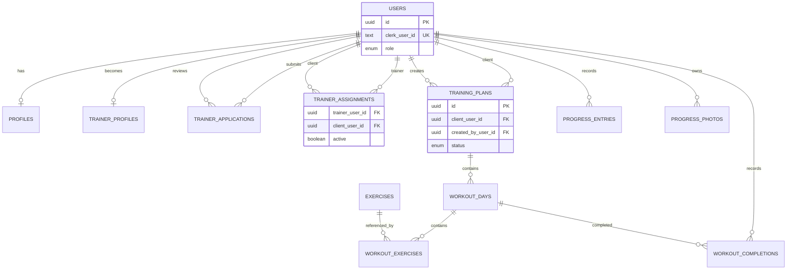

# FitPath

FitPath is a university fitness-management MVP. It helps users manage training
plans and progress, while approved trainers support their assigned clients.

## Features

- Clerk authentication with protected API access.
- USER, TRAINER, and ADMIN roles enforced by the Express API.
- First-login onboarding and profile-based BMI calculation.
- Trainer application, approval, discovery, and client-assignment workflows.
- Authorized training-plan creation, editing, workout completion, and PDF export.
- Progress measurements, private progress photos, and accessible progress charts.
- Unit tests, Cypress E2E coverage, deterministic CI, and scheduled backups.

## Roles

| Role | Permissions |
| --- | --- |
| USER | Manages a personal profile, plans, workout completions, progress, private photos, and trainer selection. |
| TRAINER | Views active assigned clients and creates or updates their training plans. |
| ADMIN | Reviews trainer applications and accesses administrative overview, users, and plans. |

Frontend visibility is for usability; the API remains the authorization boundary.

## Technology Stack

| Area | Technologies |
| --- | --- |
| Frontend | React, TypeScript, Vite, Tailwind CSS |
| Backend | Node.js, Express, TypeScript |
| Data | PostgreSQL, Neon, Drizzle ORM |
| Services | Clerk, Cloudflare R2 |
| Quality | Cypress, GitHub Actions |

## Architecture

```text
Browser
  → React SPA
  → Express API
  → Clerk / PostgreSQL (Neon) / private Cloudflare R2
```

The React client obtains a Clerk session token and calls the API. The Express
API verifies identity and role/ownership before accessing PostgreSQL or private
R2 objects.

## Database Relationships

The schema is defined in `server/src/db/schema.ts`; committed migrations in
`drizzle/` are the database source of truth. This diagram focuses on the MVP's
main ownership and workflow relationships.



Important constraints include one profile per user, one active trainer per
client, unique workout-day/exercise positions within a plan, and one workout
completion per user/workout day.

## Security and Data Boundaries

- Clerk verifies authenticated requests; the server derives the current Clerk
  identity from verified request state rather than request-body ownership fields.
- The Express API enforces role, ownership, and active trainer-assignment checks.
- R2 buckets are private. Object keys are generated server-side and private
  certificates/progress photos are delivered only through authorized API routes.
- Client-side role visibility improves navigation only; it is not relied upon
  for security.

## API Highlights

| Area | Representative routes |
| --- | --- |
| Identity/profile | `GET /api/me`, `PUT /api/me/onboarding` |
| Trainers | `/api/trainers`, `/api/me/trainer`, `/api/trainer/clients` |
| Plans | `/api/training-plans`, `/api/training-plans/:id/pdf` |
| Progress | `/api/me/progress`, `/api/me/progress-photos` |
| Administration | `/api/admin/overview`, `/api/admin/trainer-applications` |

All `/api` resource routes except the health check require the appropriate
authentication and server-side authorization. Consult the route files under
`server/src/routes/` for the complete API surface.

## Local Development

### Prerequisites

- Node.js 22 or newer
- npm 10 or newer
- A PostgreSQL database (Neon is the intended provider)
- Clerk and Cloudflare R2 test/development configuration when exercising those integrations

### Setup

```bash
npm install
copy .env.example .env
npm run db:migrate
npm run dev
```

Edit the ignored `.env` file with your own local values. Never commit
credentials. On macOS/Linux, use `cp .env.example .env` instead of `copy`.

## Environment Variables

Copy `.env.example` and use placeholders only in committed files.

- **DATABASE:** `DATABASE_URL`
- **CLERK:** `VITE_CLERK_PUBLISHABLE_KEY`, `CLERK_PUBLISHABLE_KEY`, `CLERK_SECRET_KEY`
- **R2:** `R2_ACCOUNT_ID`, `R2_ACCESS_KEY_ID`, `R2_SECRET_ACCESS_KEY`,
  `R2_BUCKET_NAME`, `R2_ENDPOINT`, plus separate `BACKUP_R2_*` and `RESTORE_R2_*` values
- **CLIENT:** `PORT`, `CLIENT_ORIGIN`, `VITE_API_URL`
- **TESTING:** Cypress local credentials belong in ignored `cypress.env.json`;
  manual E2E uses dedicated GitHub Actions secrets.

## Database Migrations

Migration SQL files are committed under `drizzle/` and are the source of truth
for the schema.

```bash
npm run db:generate
npm run db:migrate
```

`db:generate` creates a new migration for an intentional schema change.
`db:migrate` applies committed migrations. Do not use `drizzle-kit push` and do
not modify already-applied migrations.

## Testing

```bash
npm run lint
npm run typecheck
npm run test:unit
npm run build
```

The Cypress suite is documented in [docs/e2e-testing.md](docs/e2e-testing.md).
Run it only against its dedicated Clerk, Neon, and R2 test environment. The
manual `Full E2E` GitHub Actions workflow is separate from main CI.

The final end-to-end manual verification steps are in
[docs/manual-regression-checklist.md](docs/manual-regression-checklist.md).

## CI

The main `CI` workflow runs on pushes and pull requests. It uses `npm ci` and
runs linting, type checking, unit tests, and the production build without
application infrastructure secrets. Authenticated E2E is manual-only and uses
dedicated test secrets.

## Backup

The scheduled backup workflow creates a daily Neon PostgreSQL dump and private
R2 storage copy in a separate backup bucket. Retention keeps 7 daily, 5 weekly,
and 12 monthly references. See [docs/backup-and-restore.md](docs/backup-and-restore.md)
for prerequisites, restoration safeguards, and non-production restore steps.

## AI-Assisted Development

ChatGPT, coding agents, and project-specific frontend/backend agents assisted
development, review, testing guidance, and documentation. Changes were
reviewed and validated through the repository's scripts and workflows; AI did
not operate independently of project direction.

## Repository Structure

```text
client/       React SPA
server/       Express API and server-side integrations
drizzle/      Committed PostgreSQL migrations
cypress/      Cypress E2E tests
scripts/      Backup and restore automation
docs/         Architecture, testing, backup, and regression documentation
.github/      CI, E2E, and backup workflows
```

## Future Improvements

Potential post-MVP additions include notifications, richer trainer
communication, and nutrition integration. They are intentionally outside the
current MVP scope.
